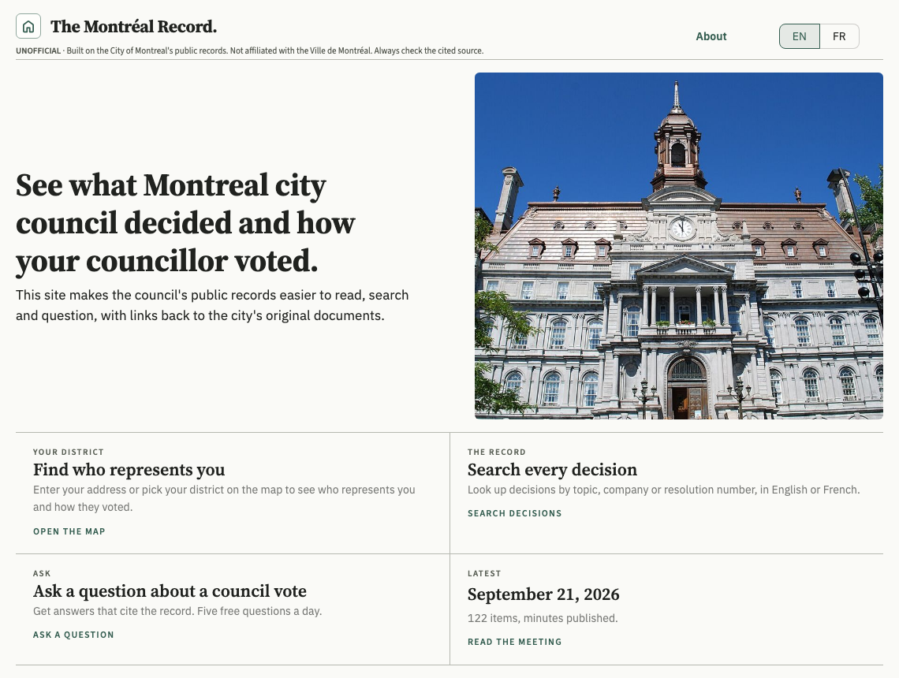
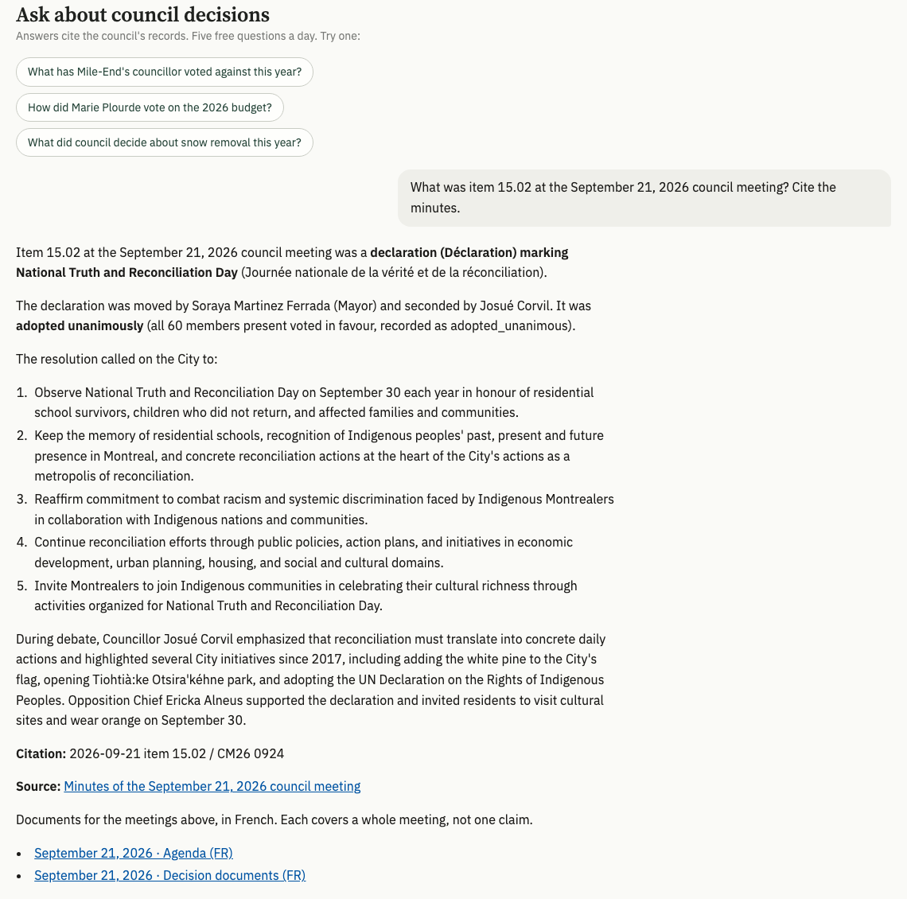
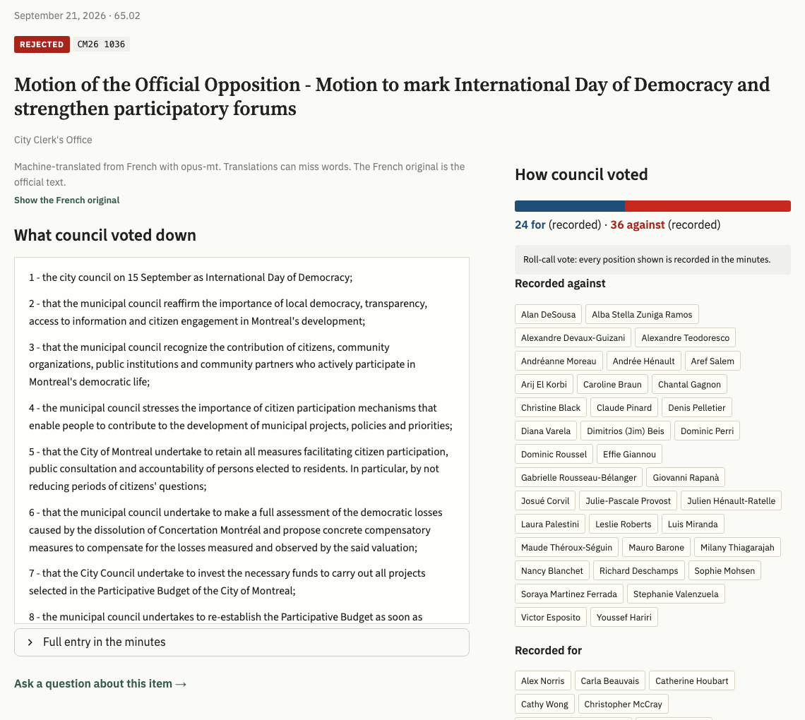
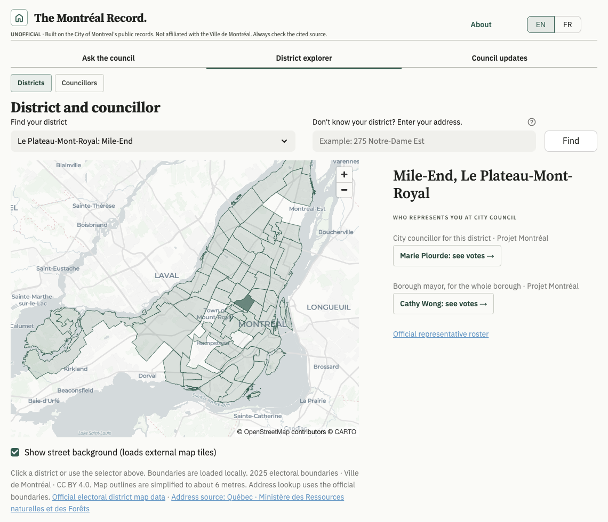

# The Montréal Record (mtl-council-agent)

A public site for what Montreal's city council decided and how each councillor voted, in English and French. It turns the city's French-only PDF records into a searchable database, and an AI agent answers questions about them with a citation for every claim.

Live at **[mtl-council-agent.streamlit.app](https://mtl-council-agent.streamlit.app)**.



> Unofficial project, not affiliated with the Ville de Montréal.

---

## What it does

| Tab | What it's for |
|---|---|
| Ask the council | Ask a question in English or French and get an answer that cites the council's records. |
| District explorer | Find who represents you, and see how they voted. |
| Council updates | Browse and search every decision and meeting. |







## How it works

```
 City council portal ──▶ 3 French PDFs per meeting ──▶ parse and join ──▶ Postgres + pgvector
 (checked weekly)        agenda · minutes ·            one record per          │
                         decision summaries            agenda item             ├──▶ website
                                                                               └──▶ AI agent
```

**The data pipeline.** Montreal publishes its council records only as PDFs, up to 4,467 pages per meeting, and each meeting has three. The agenda says what was proposed, the decision summaries explain why, and the minutes record what council adopted, who moved it, and how members voted. A weekly GitHub Actions job downloads new or revised documents, parses them, and joins the three into one record per agenda item. The records are stored in Postgres with pgvector, for both exact word search and search by meaning. The same job translates new titles and text into English with a free open-source model, and a quality check fails the run if data goes missing.

**The agent.** The chat is a Claude agent with a hand-written tool loop and five tools:
- search by meaning, in English or French;
- search by exact words, for resolution numbers and company names;
- list a meeting's items;
- read one item in full, with its vote;
- pull a councillor's record of motions and votes.

The agent decides which tools to call and cites each item it uses. Each citation is checked against the database in the eval. A few rules it follows:
- It keeps recorded votes apart from inferred ones. A unanimous vote names nobody, so it never claims to know how an individual voted unless the minutes say so.
- It declines questions outside the city council's records, such as borough decisions or future budgets.
- It runs on `claude-haiku-4-5`, and visitors get five free questions a day.

**The website** is a Streamlit app that reads the database through a read-only account, so a bug in the site can't change the data.

## Results

| Measure | Result |
|---|---|
| Meetings ingested (2026) | 12, of which 10 have published minutes |
| Agenda items | 1,339 |
| Items linked to their decision summary | 99.9% (1,123 of 1,124) |
| Individual votes recorded | 1,060 |
| Agent eval, answer and citations both correct | 82 of 85 questions |

The eval asks 85 hand-written questions and checks two things for each answer: whether it contains the right facts, and whether every item it cites exists at the meeting it names. It includes questions the agent should decline. Of the three misses, one was a grading error, since fixed, and two were the agent being too cautious with information it had.

## What was hard

- **The documents mislead quietly.** The minutes credited the opposition leader with moving 11 items she didn't, because her procedural requests came after the real motion. Another entry recorded a motion as "adopted" when council had only voted to send it to a committee. Both looked fine until checked against the source.
- **The format drifts.** One meeting's minutes dropped a colon from a heading, and that meeting lost all its attendance without any error. A weekly check now fails when a meeting's minutes yield no attendance.
- **Every fix has a test.** Each parsing problem found has a regression test built from real document excerpts, so a change in the city's format fails a test instead of corrupting data.

## Getting started

Requires Python 3.11+, `poppler-utils` (for `pdftotext`), and Postgres with `pgvector`. Neon and Supabase both work on their free tiers.

```bash
pip install -e ".[dev]"
export DATABASE_URL="postgresql://..."
export ANTHROPIC_API_KEY="sk-ant-..."

mtl-council-agent init-db
mtl-council-agent load-roster
mtl-council-agent -v ingest --since 2026-01-01
mtl-council-agent ask "Did Marie Plourde vote for or against the 2026 budget?"
```

Run the website locally:

```bash
pip install -r requirements.txt
export WEB_DATABASE_URL="postgresql://web_reader:..."
streamlit run streamlit_app.py
```

Tests run with `pytest -q`, and the eval with `python eval/run_eval.py -v`.

## Repository structure

```
src/mtl_council_agent/
  scraper/          reads the council portal and checks for new documents
  ingestion/        PDF text, parsers for the three documents, joining, embeddings
  db/               database schema and client
  agent/            the agent's tools, prompt and loop
  app/              the website's pages, queries and translations
streamlit_app.py    website entry point
scripts/            translations and one-off data fixes
eval/               question set and grader
tests/              tests built from real document excerpts
.github/workflows/  tests, weekly ingestion, translations
```

## Data sources

City data is © Ville de Montréal, used under [CC-BY 4.0](https://donnees.montreal.ca/licence-d-utilisation).

- Council agendas, minutes and decision summaries, from the City's council portal.
- Council roster and 2025 electoral districts, from [Montreal open data](https://donnees.montreal.ca/).
- Address lookup, from Québec's official [AQ Adresses service](https://servicescarto.mrnf.gouv.qc.ca/pes/rest/services/Territoire/AQ_ADRESSES_WMS/MapServer).
- Translations by the open-source [opus-mt-fr-en](https://huggingface.co/Helsinki-NLP/opus-mt-fr-en) model.
